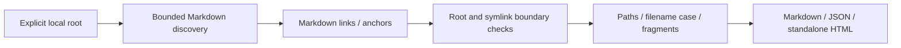

# Doc Route

**离线检查 Markdown 导航，发现失效本地路径、文件名大小写和标题锚点问题。**

**Offline Markdown navigation checks.** Review local file/directory links,
portable filename casing and common heading/custom-anchor fragments before a
release. Zero runtime dependencies. No remote URL fetching or repository execution.

## 快速开始 / Quickstart

Node.js **22+** and npm are required. From this source directory:

```sh
npm ci --ignore-scripts
npm run build
node dist/cli.js check examples/valid
node dist/cli.js check . --format json
npm test
```

To install the built command from this checkout:

```sh
npm install --global . --ignore-scripts
docroute --help
docroute check /path/to/project
```

Package name: `doc-route-cli`; executable: `docroute`. No npm registry publication
is required for source installation. Quote paths with spaces on Windows.

## 用法 / Usage

```sh
docroute check .
docroute check . --format json
docroute check . --format html --output review.html
docroute check . --fail-on warning
```

Options use separate arguments. Markdown/stdout and `--fail-on error` are the
defaults. `warning` gates warnings too; `none` emits a report without gating
findings. Output files are created exclusively and never replace existing files.

| Exit | Meaning |
| --- | --- |
| `0` | Completed; requested threshold not crossed |
| `1` | Invalid arguments, unreadable input, encoding/limit or I/O failure |
| `2` | Completed report crossed the requested finding threshold |

## 能检查什么 / Checks

- Inline links and images, balanced labels/parentheses, angle destinations and
  optional quoted titles on one line.
- Forward reference definitions, full/collapsed references and defined shortcut
  references. Undefined ordinary bracket text is left alone.
- Local target existence and **exact filename case on every platform**.
- ATX and Setext headings, common formatting, duplicate heading suffixes,
  explicit first-attribute `a id` / `a name` anchors.
- Ignore fenced code, indented code, inline code and HTML comments.

| Finding | Level | Meaning |
| --- | --- | --- |
| `MISSING_TARGET` | Error | Local path was not found |
| `CASE_MISMATCH` | Error | Actual entry has different filename case |
| `MISSING_ANCHOR` | Error | No recognized heading/custom anchor matches |
| `UNRESOLVED_REFERENCE` | Error | Explicit reference definition was not found |
| `OUTSIDE_ROOT` / `INVALID_TARGET` | Error | Target escapes the root or uses an unsupported local path |
| `DUPLICATE_REFERENCE` | Warning | First reference definition is used |
| `SYMLINK_TARGET` | Warning | Target passes through a skipped symlink/junction |
| `FRAGMENT_UNCERTAIN` | Warning | Complex headings prevent a conclusive result |
| `FRAGMENT_UNVERIFIED` | Warning | Target is not scanned Markdown |

Heading behavior follows a conservative subset of [GitHub's section/relative-link
rules](https://docs.github.com/en/get-started/writing-on-github/getting-started-with-writing-and-formatting-on-github/basic-writing-and-formatting-syntax).
Paths starting `/` are resolved under the supplied project root; other paths are
relative to the source document. URL-encoded paths and fragments are decoded.
Queries are excluded from reports. Custom anchors do not affect heading suffixes.

## 例子 / Example

```markdown
# Home
[Guide](guide.md#install)
[Missing page](missing.md)
[Wrong case](Guide.md)
[Missing anchor](guide.md#unknown)
```

With an existing `guide.md` containing `# Install`, the first link resolves and
the other three produce errors. The [HTML example](examples/report.html) and
[Markdown example](examples/report.md) demonstrate this using synthetic inputs.
Regenerate them after building with `node tools/generate-example.mjs`.

The valid [example project](examples/valid/README.md) is runnable. Broken Markdown
inputs are generated only in a temporary directory, so the repository can audit
its own documentation without deliberate errors.

## 范围与边界 / Scope and limits

This is a bounded Markdown checker. It does not implement all CommonMark, MDX,
embedded templates, site-generator routing or every GitHub slug detail. Link labels,
destinations/titles and reference definitions must use the documented single-line
forms. Complex entities/HTML in headings make missing-fragment checks uncertain.
Unsupported syntax can be missed; a clean report is not proof of complete navigation.

Only `.md` / `.markdown` documents are read. Hidden directories are skipped except
`.github`; `node_modules`, `dist`, `build`, `coverage`, `reports`, `release-artifacts`
and `venv` are also skipped. These are fixed directory rules, not gitignore parsing.
Files merely existing locally may still be absent from a Git commit or published site.

Symlinks/junctions are skipped, including components in a target path. The checker
does not read through them or follow `..` outside the root. Drive-letter paths,
backslashes, decoded control characters and UNC roots are rejected. Remote and
other URI schemes are categorized without being opened.

Bounds: 10000 enumerated entries, 1000 Markdown documents, 2 MiB per document,
32 MiB total content, 20000 links, 100000 lines/10000 anchors per document,
64 KiB per line and 32 nested link brackets/parentheses. This is not an atomic
filesystem snapshot or a sandbox against malicious concurrent modifications.

## 报告隐私 / Report handling

Reports contain relative source/target paths, fragments, line numbers and finding
codes. They omit source paragraphs, absolute project roots, external URL values
and query strings. Paths/fragments can still be sensitive: review before sharing.

HTML is standalone, with escaped text, no active/external assets and a restrictive
CSP. JSON schemaVersion is 1. Unchanged inputs produce deterministic output.
The CLI never edits, repairs, copies or deletes source documents.

## 架构 / Architecture



`files.ts` owns bounded discovery and metadata checks; `markdown.ts` recognizes
the supported syntax; `audit.ts` resolves checks; `render.ts` formats reports;
`cli.ts` handles arguments, gates and exclusive output. Library exports are in
`dist/index.js` after building.

## 开发与贡献 / Development

```sh
npm ci --ignore-scripts
npm test
npm run build
npm run check:security
npm run check:package
```

The package check installs a tarball offline and invokes the installed command.
CI covers Linux, Windows and macOS. Source tests include real temporary files,
symlink/junction boundaries, invalid encodings and injected HTML. Development
dependency installation and GitHub publication use network; checking does not.

See [CONTRIBUTING.md](CONTRIBUTING.md), [AGENTS.md](AGENTS.md), [SECURITY.md](SECURITY.md),
[specification](docs/spec.md) and [90-day plan](docs/maintenance-plan.md).
中文反馈欢迎。

## License

[MIT](LICENSE), Copyright (c) 2026 Doc Route contributors.
